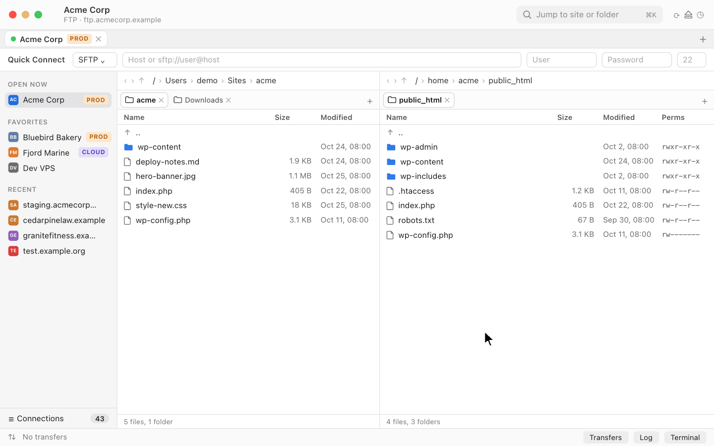

# Dockyard

A free, native macOS file-transfer client (SFTP, FTP/FTPS, and cloud storage through rclone).

<picture>
  <source media="(prefers-color-scheme: dark)" srcset="docs/screenshots/main-dark.png">
  
</picture>

- **Folder tabs**: each pane, local and server, has its own tabs, so you can keep many folders open per connection. ⌘T opens a tab and ⌘-click opens a folder in a new one. Each pane also has a folder tree, breadcrumbs, back/forward history and pinned folders.
- **Many connections in one window**: every connection gets its own tab. Group tabs, like Chrome's tab groups, to see those servers side by side in columns, each column with its own folder tabs. Drag files between columns to copy from one server to another (hold ⌥ to move). Groups are saved and can be recoloured, collapsed and reopened.
- **Session restore**: when you reconnect, your last local and server tabs come back with their folders and tree expansion as you left them, plus a notice with Start fresh.
- **Connections save themselves**: every Quick Connect goes straight into the connection manager. There's no "save?" prompt; delete what you don't want.
- **Connections at scale**: a connection manager for 200+ accounts with search, filters, favorites, colour labels and website icons. It also has [WHM sync](docs/whm.md), one-click cPanel/WHM login and imports from FileZilla, Transmit, Cyberduck, `~/.ssh/config` and 1Password. Test every connection at once and remove the broken ones, with undo.
- **Transfers**: a persistent queue that handles 100,000+ items, per-site connection limits, FileZilla-style overwrite rules, a Transfers tab with Active/Queued/Failed/Done, and a launch prompt for leftover transfers. Server-to-server copies are relayed through your Mac: each file is downloaded to a temporary folder, then uploaded to the other server.
- **SSH**: libssh2 with key, password, keyboard-interactive, ssh-agent and 1Password SSH agent; jump hosts; a terminal drawer with su/sudo and snippets; browse files as root.
- **Safety**: undo for moves and renames, optional versions on overwrite, PROD confirmations and read-only sites, optional checksums.
- **More**: compare/sync, zip/tar/extract on the server, remote search, watch folders, edit in your own editor, Quick Look, map folders to website URLs and copy a file's web address, encrypted export.



Requires macOS 14+. Swift 6, SwiftUI + AppKit.

## Download

Get `Dockyard-X.Y.Z.zip` from [Releases](https://github.com/jeremyhaber/Dockyard/releases/latest), unzip it and move Dockyard to Applications. Releases are signed with a self-signed certificate rather than an Apple one, so the first launch is blocked: open Dockyard once, then go to System Settings, Privacy & Security and click **Open Anyway** (or run `xattr -dr com.apple.quarantine /Applications/Dockyard.app`). Later versions install through Dockyard, Check for Updates.

## Screenshots

| | |
|---|---|
|  |  |
| **Connection manager**: sources, filters and a bulk connection test | **Side by side**: grouped tabs as columns, drag to copy between servers |
|  |  |
| **Transfers**: Active, Queued, Failed and Done | **Terminal**: SSH shell with su/sudo and snippets |
|  |  |
| **Compare and sync**: push or pull only what differs | **Connection editor**: jump hosts, keys, agent and 1Password |

Screenshots come from the built-in demo mode, so every site, host and file in them is made up.

## Build

```
brew install xcodegen
cd App && xcodegen && open Dockyard.xcodeproj
```

Run with `-DockyardDemo YES` to start with sample data and no network access. See [docs/app.md](docs/app.md) for the app layout, signing, the Finder extension and releases.

To regenerate the screenshots, build the app and run `RUNNER_TEMP=$(mktemp -d) scripts/ci/screenshots.sh <path to Dockyard.app> <output dir>`. The tabs animation is a scripted mock of the window rather than a recording; see `scripts/readme-animation/capture.mjs` to re-render it.

## Docs

- [docs/HANDOFF.md](docs/HANDOFF.md): the full spec
- [docs/whm.md](docs/whm.md): setting up a WHM server and key login for its accounts
- [docs/app.md](docs/app.md): app architecture and release steps
- [docs/rclone.md](docs/rclone.md): cloud backends
- [docs/onepassword.md](docs/onepassword.md): 1Password setup
- [docs/phase0-findings.md](docs/phase0-findings.md): library decisions

## About

<a href="https://simplistics.ca">
  <picture>
    <source media="(prefers-color-scheme: dark)" srcset="docs/images/simplistics-logo-white.png">
    
  </picture>
</a>

Made by Jeremy Haber, one of the owners of [Simplistics Web Design Inc.](https://simplistics.ca), a web design studio in Toronto. We built Dockyard for our own day-to-day agency work, because we wanted a modern FTP/SFTP client and couldn't find one we liked.
