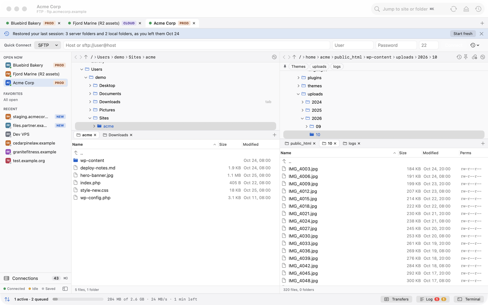
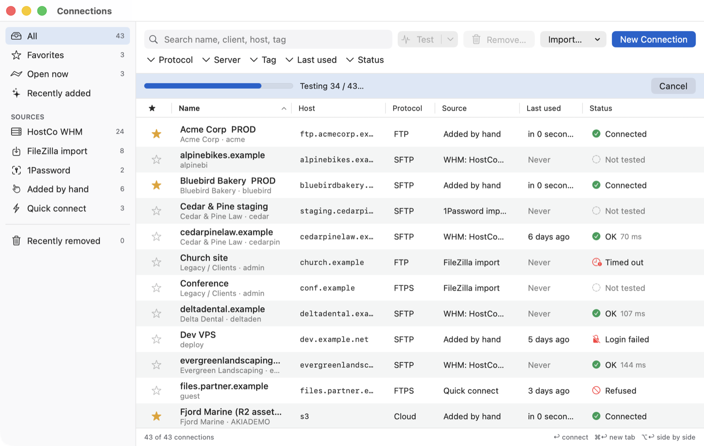
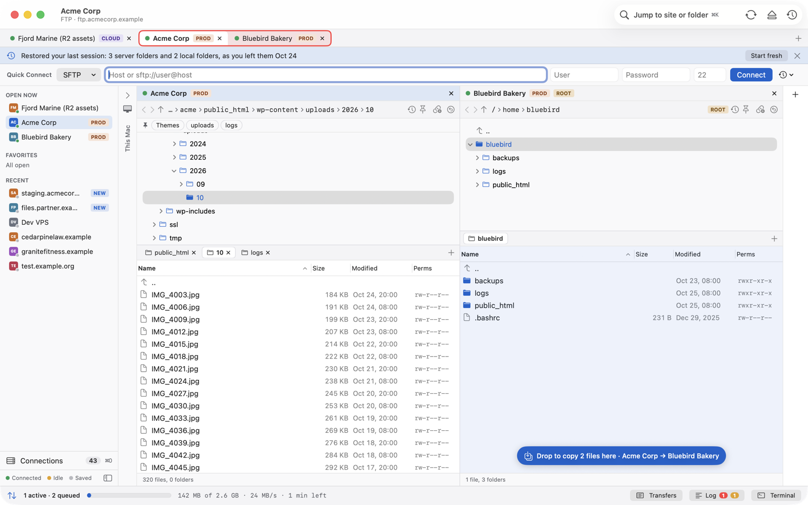
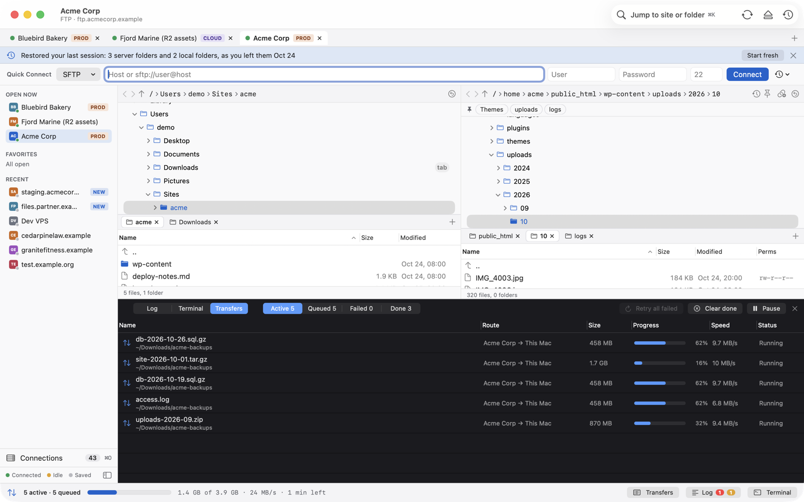
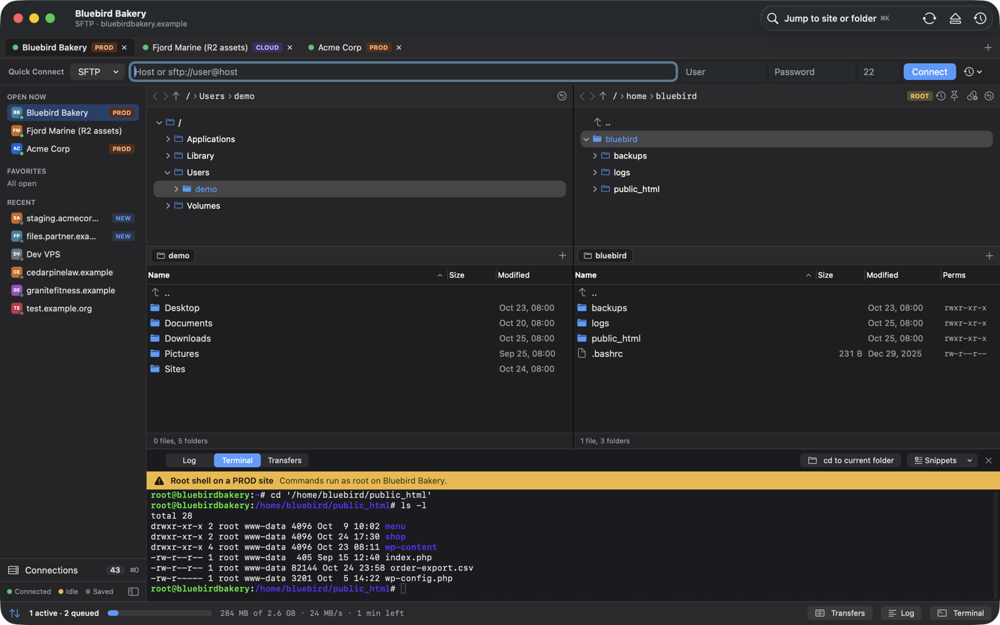
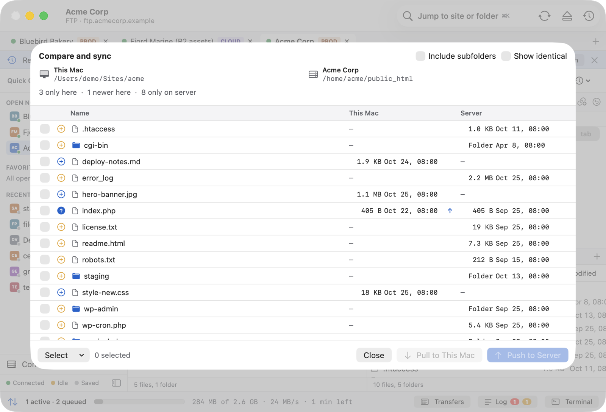
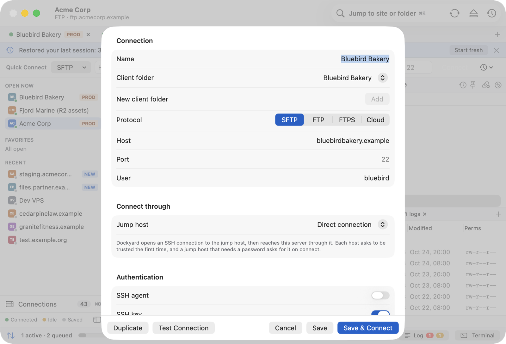

# Dockyard

A free, native macOS file-transfer client (SFTP, FTP/FTPS, and cloud storage through rclone), built to replace FileZilla.

<picture>
  <source media="(prefers-color-scheme: dark)" srcset="docs/screenshots/main-dark.png">
  
</picture>

- **Connections at scale**: a connection manager for 200+ accounts with search and filters, WHM sync, one-click cPanel/WHM login, and imports from FileZilla, Transmit, Cyberduck, `~/.ssh/config` and 1Password. Test all connections and remove broken ones, with undo.
- **FileZilla-style layout**: dual panes with folder tabs, a folder tree, breadcrumbs, folder history, pinned folders and session restore.
- **Transfers**: a persistent queue that handles 100,000+ items, per-site connection limits, FileZilla-style overwrite rules, a Transfers tab with Active/Queued/Failed/Done, and a launch prompt for leftover transfers.
- **SSH**: libssh2 with key, password, keyboard-interactive, ssh-agent and 1Password SSH agent; jump hosts; a terminal drawer with su/sudo; browse files as root.
- **Safety**: undo for moves and renames, optional versions on overwrite, PROD confirmations and read-only sites, optional checksums.
- **More**: servers side by side, compare/sync, zip/tar/extract on the server, remote search, watch folders, edit in your own editor, Quick Look, encrypted export, mount as a drive in Finder.

Requires macOS 14+. Swift 6, SwiftUI + AppKit.

## Screenshots

| | |
|---|---|
|  |  |
| **Connection manager**: sources, filters and a bulk connection test | **Side by side**: copy straight between two servers |
|  |  |
| **Transfers**: Active, Queued, Failed and Done | **Terminal**: SSH shell with su/sudo and snippets |
|  |  |
| **Compare and sync**: push or pull only what differs | **Connection editor**: jump hosts, keys, agent and 1Password |

Screenshots come from the built-in demo mode, so every site, host and file in them is made up.

## Build

```
brew install xcodegen
cd App && xcodegen && open Dockyard.xcodeproj
```

Run with `-DockyardDemo YES` to start with sample data and no network access. See [docs/app.md](docs/app.md) for the app layout, signing, the Finder extension and releases.

To regenerate the screenshots, build the app and run `RUNNER_TEMP=$(mktemp -d) scripts/ci/screenshots.sh <path to Dockyard.app> <output dir>`.

## Docs

- [docs/HANDOFF.md](docs/HANDOFF.md): the full spec
- [docs/app.md](docs/app.md): app architecture and release steps
- [docs/rclone.md](docs/rclone.md): cloud backends
- [docs/onepassword.md](docs/onepassword.md): 1Password setup
- [docs/phase0-findings.md](docs/phase0-findings.md): library decisions
